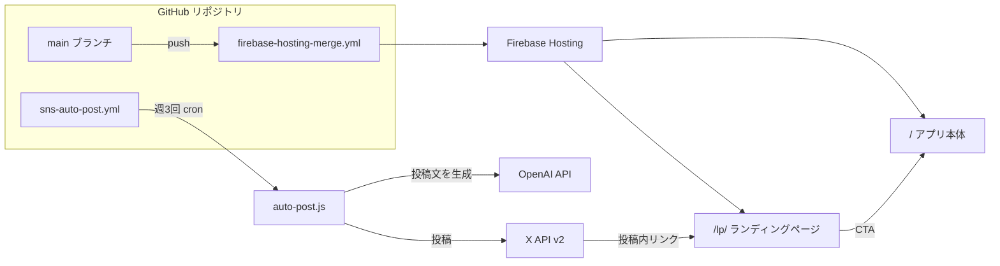
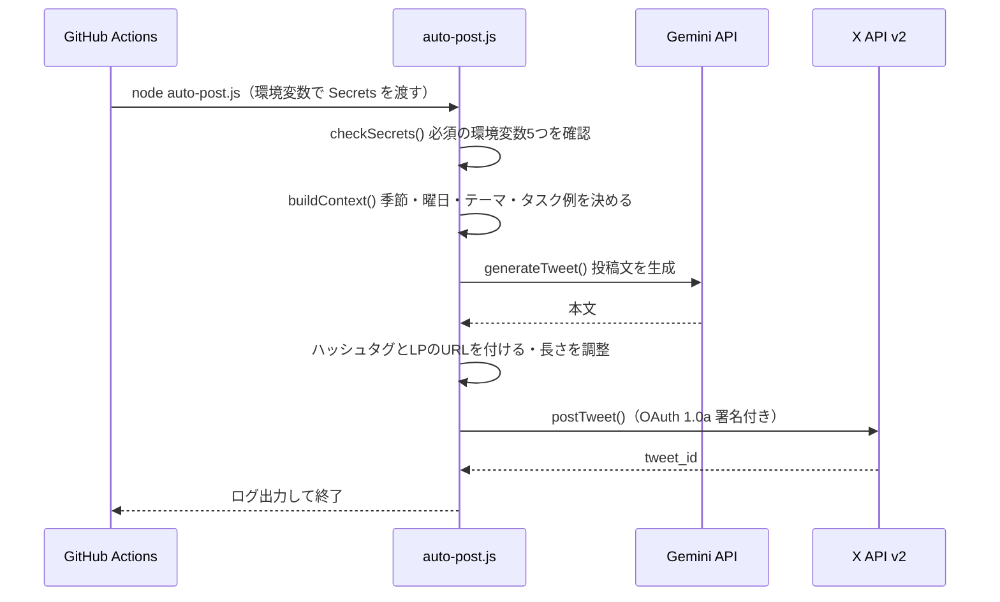

# おうちリズム — 拡散施策 実装仕様書

> 対象：拡散施策のチャットで作成・変更したコード／アプリ本体のUI改善（9章）
> 関連ドキュメント：[KAKUSAN_PLAN.md](./KAKUSAN_PLAN.md)（施策計画） / [DEPLOY.md](./DEPLOY.md)（環境・デプロイ）

---

## 1. 概要

| 項目 | 内容 |
|------|------|
| アプリ名 | おうちリズム |
| アプリ形態 | ブラウザで動くウェブアプリ（PWAではない。manifest.json・Service Worker なし） |
| ターゲット | 家事のスケジュールを管理したい人・家事の予定表を作りたい人 |
| 施策の目的 | 利用者を増やすこと。AIで自動化できる仕組みを優先する |
| 本番URL（アプリ） | https://kakusan-25200.web.app/ |
| 本番URL（LP） | https://kakusan-25200.web.app/lp/ |

### 1.1 成果物一覧

| ファイル | 種別 | 役割 |
|---------|------|------|
| `lp/index.html` | 新規 | ランディングページ（LP） |
| `lp/og-image.svg` | 新規 | OGP画像（1200×630） |
| `.github/scripts/auto-post.js` | 新規 | AIでX（Twitter）に自動投稿するスクリプト |
| `.github/workflows/sns-auto-post.yml` | 新規 | 自動投稿を定期実行する GitHub Actions |
| `firebase.json` | 変更 | LPのキャッシュ設定・ignore追加・SVGのキャッシュ対応 |
| `DEPLOY.md` | 変更 | PWAでないことを明記・Cloudflare Pagesを開発者専用と明記 |
| `KAKUSAN_PLAN.md` | 新規 | 拡散施策の計画書 |
| `KAKUSAN_SPEC.md` | 新規 | 本書 |

### 1.2 全体構成



---

## 2. ランディングページ `lp/index.html`

### 2.1 基本仕様

| 項目 | 内容 |
|------|------|
| 構成 | 1ファイルで完結するHTML（CSSは `<style>` に埋め込み、JavaScriptなし） |
| 外部依存 | なし（フォント・画像・スクリプトを外部から読み込まない） |
| 配信パス | `/lp/`（Firebase Hosting が `lp/index.html` を返す） |
| キャッシュ | `no-cache`（`firebase.json` で指定） |
| レスポンシブ | 600px 以下で1カラムに切り替え |
| CSP | 既存CSPの範囲内で動作（インラインスタイルは `style-src 'unsafe-inline'` で許可済み） |

### 2.2 デザイントークン（アプリ本体 `style.css` から流用）

| 変数 | 値 | 用途 |
|------|----|------|
| `--g900` / `--g800` | `#1a3a2a` / `#1f4d33` | 見出し・フッター |
| `--g500` | `#4caf7d` | メインカラー・CTAボタン |
| `--g100` / `--g50` | `#eaf8f1` / `#f4fbf7` | セクション背景 |
| `--amber` / `--amber-lt` | `#e8a020` / `#fef3d8` | バッジ |
| `--lavender` | `#8b72be` | パートナー共有機能のアイコン |
| `--muted` | `#7a9b8a` | 補足テキスト |
| `--font` | `"Hiragino Sans", "Meiryo", "Yu Gothic UI", system-ui, sans-serif` | 本文フォント |

### 2.3 セクション構成

| # | id / 要素 | 内容 |
|---|----------|------|
| 1 | `nav.lp-nav` | 上部に固定するナビ。ロゴと「無料で使う」ボタン |
| 2 | `#hero` | キャッチコピー「家事の予定表をかんたんに作れるウェブアプリ」、CTA 2つ、カレンダーUIのモック（HTML/CSSで描画） |
| 3 | `#problems` | よくある悩み4つ（前回の掃除日を忘れる／家事が見えない／分担の摩擦／頻度の低い掃除を忘れる） |
| 4 | `#features` | 機能紹介4つ（カレンダー管理／住居タイプ別のタスク提案／パートナー共有／アカウントなしで使える＋クラウド同期） |
| 5 | `#howto` | 3ステップ（住居タイプ設定 → タスク追加 → カレンダーで確認・記録） |
| 6 | `#target` | おすすめのユーザー像6つ |
| 7 | `#cta` | 最後のCTA「無料で使いはじめる」 |
| 8 | `footer` | アプリへのリンク・プライバシーポリシーへのリンク・コピーライト |

### 2.4 リンク先

| 要素 | リンク先 |
|------|---------|
| ナビCTA / ヒーローCTA / 最後のCTA | `https://kakusan-25200.web.app/` |
| 「機能を見る」 | `#features`（ページ内スクロール） |
| フッターのプライバシーポリシー | `https://kakusan-25200.web.app/privacy.html` |

### 2.5 メタタグ

| タグ | 値 |
|------|----|
| `<title>` | おうちリズム — 家事の予定表をかんたん管理 |
| `description` | 掃除・洗濯・料理など家事のスケジュールをカレンダーで一元管理。（以下略） |
| `og:title` / `twitter:title` | おうちリズム — 家事の予定表をかんたん管理 |
| `og:image` / `twitter:image` | `https://kakusan-25200.web.app/lp/og-image.svg` |
| `og:url` | `https://kakusan-25200.web.app/lp/` |
| `og:type` / `og:site_name` | `website` / おうちリズム |
| `twitter:card` | `summary_large_image` |

---

## 3. OGP画像 `lp/og-image.svg`

| 項目 | 内容 |
|------|------|
| サイズ | 1200 × 630（`viewBox="0 0 1200 630"`） |
| 形式 | SVG（テキストとベクター図形のみ。外部リソースなし） |
| 左側（x: 0〜700） | ロゴ、「無料・登録不要で使える」バッジ、3行のキャッチコピー、説明文、URL |
| 右側（x: 700〜1200） | 濃い緑の背景にカレンダーUIのモックカード（ジャンルタグ・日付グリッド・タスク3件） |
| キャッシュ | `public, max-age=31536000, immutable`（`**/*.svg` のパターンで指定） |

> ⚠️ 注意点は [7. 既知の課題](#7-既知の課題) の #1 を参照してください。

---

## 4. AI自動投稿スクリプト `.github/scripts/auto-post.js`

### 4.1 基本仕様

| 項目 | 内容 |
|------|------|
| 実行環境 | Node.js 20（GitHub Actions `ubuntu-latest`） |
| 依存パッケージ | なし（Node.js 標準の `https` と `crypto` のみ） |
| 生成AI | Gemini API（`gemini-2.0-flash`、無料枠） |
| 投稿先 | X API v2 `POST https://api.twitter.com/2/tweets` |
| X の認証方式 | OAuth 1.0a（HMAC-SHA1 署名をスクリプト内で生成） |
| 失敗時 | エラーメッセージを出して終了コード 1 で終了（Actions のジョブも失敗になる） |

### 4.2 処理の流れ



### 4.3 定数

| 定数 | 値 |
|------|----|
| `APP_NAME` | `おうちリズム` |
| `APP_URL` | `https://kakusan-25200.web.app/lp/` |
| `HASHTAGS` | `#家事 #掃除 #暮らし #おうちリズム` |
| `DAY_NAMES` | 日曜日〜土曜日 |
| `TASK_EXAMPLES` | トイレ掃除（週1）、コンロ掃除（月1）、浴室掃除（週1）、エアコンフィルター掃除（3ヶ月に1回）、窓拭き（年2回）、排水口掃除（月1） |

### 4.4 投稿テーマ `THEMES`

| index | type | プロンプトの内容 |
|-------|------|----------------|
| 0 | `tips` | 季節感のある家事・掃除のコツ。最後に「おうちリズムで{タスク例}を登録して習慣化しよう」と添える |
| 1 | `seasonal` | その季節ならではの家事ネタ。「おうちリズムでスケジュール管理すると楽」と自然に入れる |
| 2 | `feature` | アプリの機能を1つ紹介。曜日に合わせた軽いトーン |

どのテーマも「140字以内・ハッシュタグなし」を指示しています。システムプロンプトは「家事・暮らし系SNSアカウントの運用担当。親しみやすく実用的。絵文字は1〜2個」です。

### 4.5 関数

| 関数 | 入力 | 出力 | 説明 |
|------|------|------|------|
| `getSeason(month)` | 月（1〜12） | `春`/`夏`/`秋`/`冬` | 3〜5月=春、6〜8月=夏、9〜11月=秋、それ以外=冬 |
| `buildContext()` | 環境変数 `POST_INDEX` | `{month, season, dayOfWeek, taskExample, themeIndex}` | `idx = POST_INDEX` があればその値、なければ日にち（1〜31）。テーマは `idx % 3`、タスク例は `idx % 6` |
| `generateTweet(theme, ctx)` | テーマとコンテキスト | `Promise<string>` | OpenAI を呼び出す。`error` が返る、または本文が空なら reject |
| `oauthSign(method, url, params, ck, cs, tk, ts)` | OAuth の各値 | `Authorization` ヘッダー文字列 | nonce は `crypto.randomBytes(16)`。パラメータを並べ替えてベース文字列を作り、HMAC-SHA1で署名 |
| `postTweet(text)` | 投稿文 | `Promise<object>` | HTTP 400 以上なら reject |
| `checkSecrets()` | — | — | 環境変数が足りなければ、足りない名前を並べて throw |
| `main()` | — | — | 上の関数を順番に呼ぶ |

### 4.6 投稿文の組み立て

```
{AIが生成した本文}

#家事 #掃除 #暮らし #おうちリズム
https://kakusan-25200.web.app/lp/
```

組み立てた文字列の `length` が 280 を超えたら、本文を200文字で切って「…」を付けます（注意点は [7. 既知の課題](#7-既知の課題) の #2）。

### 4.7 環境変数

| 変数 | 必須 | 渡し方 | 内容 |
|------|------|--------|------|
| `GEMINI_API_KEY` | ✅ | GitHub Secrets | Google AI Studio（Gemini）APIキー（無料） |
| `X_API_KEY` | ✅ | GitHub Secrets | X の Consumer Key |
| `X_API_SECRET` | ✅ | GitHub Secrets | X の Consumer Secret |
| `X_ACCESS_TOKEN` | ✅ | GitHub Secrets | X のアクセストークン |
| `X_ACCESS_SECRET` | ✅ | GitHub Secrets | X のアクセストークンシークレット |
| `POST_INDEX` | — | ワークフローの入力 | テーマを手動で選ぶときに使う |

認証情報はすべて環境変数から読み込み、コードやログには出しません。

---

## 5. GitHub Actions `.github/workflows/sns-auto-post.yml`

| 項目 | 内容 |
|------|------|
| ワークフロー名 | SNS Auto Post |
| 定期実行 | `0 0 * * 1`（月 09:00 JST） / `0 0 * * 4`（木 09:00 JST） / `0 1 * * 6`（土 10:00 JST） |
| 手動実行 | `workflow_dispatch`。入力 `post_index`（0=tips / 1=seasonal / 2=feature、初期値 `0`） |
| ランナー | `ubuntu-latest`、タイムアウト5分 |
| ステップ | `actions/checkout@v4` → `actions/setup-node@v4`（Node 20） → `node .github/scripts/auto-post.js` |
| `POST_INDEX` | 手動実行では入力値、定期実行では空文字（スクリプトが日にちで決める） |

GitHub の cron は UTC で動き、混んでいると数分〜数十分遅れることがあります。

---

## 6. 設定ファイルの変更

### 6.1 `firebase.json`

| 変更 | 内容 |
|------|------|
| `ignore` に追加 | `KAKUSAN_PLAN.md`、`SHORTCUT_GUIDE.md`（Hosting で公開しない） |
| headers に追加 | `lp/index.html` → `Cache-Control: no-cache` |
| immutable の対象を拡大 | `**/*.@(js|css|webp|png)` → `**/*.@(js|css|webp|png|svg)` |

### 6.2 `DEPLOY.md`

- 冒頭に「ブラウザ動作のみ保証。PWAではない」という注意を追加
- 環境一覧に「用途」の列を追加
  - エンドユーザー向け：Firebase Hosting（正式URL）、GitHub Pages
  - 開発者専用：Cloudflare Pages（`okomedev.pages.dev` / `ouchirhythm.pages.dev`）、ローカル

### 6.3 同じコミットに含めた既存の変更（`auth.js`）

このチャットの前から作業ツリーにあった変更を、LP追加のコミットに一緒に含めています。

- `_shouldFallbackToRedirect()` のフォールバック対象から `auth/unauthorized-domain` を外した（リダイレクトに切り替えても解決しないため）
- `initAuth()` の Firebase 未設定時の処理の最後に `updateAuthUI(null)` を追加

---

## 7. 既知の課題

| # | 課題 | 影響 | 対策案 |
|---|------|------|--------|
| 1 | **X・Facebook・LINE は OGP画像に SVG を使えない**（PNG/JPEG/WebP/GIF のみ対応） | シェアしたときにサムネが出ない | `og-image.svg` を 1200×630 の PNG に書き出して `lp/og-image.png` を置き、`og:image` / `twitter:image` を `.png` に戻す |
| 2 | 投稿の長さを `String.length` で判定している。X では日本語1文字が2、URLは一律23として数える | 日本語の本文が長いと X API がエラーを返し、投稿に失敗する | X の数え方（`twitter-text` 相当）で判定するか、本文の上限を全角100文字くらいに抑える |
| 3 | `generateTweet()` / `postTweet()` に HTTP のタイムアウトがない | API が応答しないときはジョブの5分タイムアウトまで待つ | `req.setTimeout()` で 30 秒くらいに設定する |
| 4 | 同じ日にちで同じテーマとタスク例が選ばれ、過去の投稿と重複しているか確認していない | 似た内容の投稿が続くことがある | 投稿ログを保存して重複を避ける（計画書の「Firestoreに投稿ログを保存」は未実装） |
| 5 | LPのモックとOGP画像のカレンダーは「2025年7月」の固定表示で、曜日の並びは実際のカレンダーと一致しない | 見た目だけの問題 | 必要なら実際の暦に合わせて直す |
| 6 | `KAKUSAN_PLAN.md` に実装と合わない記述が残っている（cron のJST表記、`og-image.png`、GPT-4o、Instagram・Firestore 連携） | 計画書を読む人が混乱する | 本書を正として計画書の記述を直す |

---

## 8. 運用を始める手順（手作業）

1. X アカウントを作る（例：`@ouchirhythm`）
2. X Developer Portal でアプリを登録し、権限を **Read and Write** にしてから Access Token を発行する
3. OpenAI の APIキーを取得する
4. GitHub → Settings → Secrets and variables → Actions に、[4.7](#47-環境変数) の5つを登録する
5. Actions → 「SNS Auto Post」→ 「Run workflow」でテスト投稿する
6. [7. 既知の課題](#7-既知の課題) の #1（PNG化）と #2（文字数の判定）を直してから定期実行に任せる

---

## 9. アプリ本体のUI改善（スマホ）

対象ファイル：`index.html` / `app.js` / `style.css`

### 9.1 変更一覧

| # | 項目 | 変更前 | 変更後 |
|---|------|--------|--------|
| 1 | かくさん（フローティングキャラ） | 常に右下に表示され、タスクと重なる | スクロールダウンで下部ナビと一緒に隠れ、上スクロールで再表示 |
| 2 | スクロール感度 | 60px 以上の下スクロールで隠れる | 6px 以上で隠れる（ページ上端 40px 以内は常に表示） |
| 3 | タスクのジャンル | ジャンル選択欄（select）で選ぶ | 選択欄を廃止。タスク名の下に自動判定結果を表示 |
| 4 | タスクの周期 | 丸ボタンが折り返して並ぶ（なし／毎日／週1／月1／3ヶ月／年1／〇日ごと） | 3列×2段のボタン（毎日／毎週／毎月／3ヶ月／毎年／日数指定） |
| 5 | 生理周期の設定 | 設定画面 | 生理画面（ミニカレンダーの下「周期の設定」） |
| 6 | 住まい・掃除レベル | 設定画面でのみ設定 | 初回起動時に「はじめに教えてね」画面で設定。以降は設定画面で変更 |
| 7 | JSONエクスポート | 設定画面にボタンあり | 削除 |
| 8 | カレンダー | 小さい日付マス＋色ドット。下に「この日のタスクはありません」バナーと日付・ボタン行 | Googleカレンダー風の大きいマスにタスク名を表示。バナーと日付・ボタン行は削除 |
| 9 | 日付計算 | `toISOString()`（UTC）で日付を作るため、日本時間 0〜9時は前日扱い | ローカル時刻で `YYYY-MM-DD` を作る |
| 10 | タスクの日付 | 指定できない（くり返しは完了日から、単発は常に今日に表示） | タスク名の上に日付欄（「今日」／「日付を選ぶ」）。くり返しの場合は開始日 |
| 11 | タスク追加・編集モーダル中のかくさん | モーダルの前面に表示され、メモ欄などと重なる | モーダル表示中は非表示 |

難易度（軽め／普通／重め）は据え置き。スコア計算 `estimateTaskScore()` のベース係数として使い続ける。

### 9.2 かくさんの表示制御

- 下部ナビの自動非表示処理（`app.js` 末尾の Bottom Nav IIFE）で、`.bottom-nav` に `nav--hidden`、`#chara-float` に `chara--hidden` を同時に付け外しする
- `.chara-float.chara--hidden` は `translateY` で画面外に移動し `opacity: 0`。子要素の `pointer-events` も無効にする
- PC（768px 以上）では常に表示
- タスク追加・編集モーダル（`#modal-task`）の表示中は非表示：`body:has(#modal-task:not(.hidden)) .chara-float { display: none; }`

| 定数 | 値 | 意味 |
|------|----|------|
| `HIDE_THRESHOLD` | 6 | 1フレームでこの量以上下にスクロールしたら隠す |
| `SHOW_BUFFER` | 10 | この量以上上にスクロールしたら表示 |
| `TOP_GUARD` | 40 | ページ上端からこの範囲内は常に表示 |

### 9.3 タスク追加・編集モーダル

**項目の並び**：日付 → タスク名（＋ジャンル）→ くり返し → 難易度 → メモ

**日付**
- `#task-date-pick`：「今日」ボタン（`.date-chip[data-offset="0"]`）と「日付を選ぶ」ボタン（`.date-chip-picker`。透明な `input[type=date]#input-task-date` を重ねる）
- 今日以外を選ぶと「日付を選ぶ」ボタンに日付（`D.jpFull()`）を表示し、選択中の色にする
- 状態は `modalDate`（選択中の日付）と `modalDateDirty`（編集時に日付を変えたか）で管理し、`setModalDate(date)` で表示を更新
- 新規追加：カレンダーで選択中の日が初期値（過去日なら今日）。保存時は常に `startDate` を保存
- 編集：次回予定日（`nextDue()`）を表示。日付を変えた場合のみ `startDate` を保存

**`startDate` と `nextDue(task)`**
- 単発タスク（`cycle: 'none'`）：未完了なら `startDate`（なければ今日）を返す
- くり返し：`startDate` が `lastDone` より後ならそれを返し、そうでなければこれまで通り完了日から周期で数える
- 既存タスクは `startDate` を持たないため、動きは変わらない

**ジャンル**
- `<select id="input-task-genre">` を廃止し、タスク名入力欄の下に `ジャンル <span id="genre-auto-hint">` を表示
- 判定は既存の `guessGenre(name)`（`GENRE_KEYWORDS` のキーワード一致）をそのまま使う
- 判定結果はモジュール変数 `modalGenre` に保持し、`updateGenreHint()` で表示を更新
  - 判定できた：ジャンル名を表示
  - 判定できない：「未設定（タスク名から自動判定）」と表示し、保存時は `other`（その他）になる
- 編集時は既存の `genre` を初期値にし、名前を変えて判定できた場合のみ上書きする

**くり返し（周期）**
- `.radio-group.cycle-seg`：3列グリッドのボタン。選択中は緑で塗る
- 選択中のボタンをもう一度押すと解除 → `cycle: 'none'`（1回だけのタスク）
- 「日数指定」を選ぶと `#custom-days-row`（`.cycle-custom.show`）を表示。−／＋ボタン（`.cycle-step`）で 1〜999 の範囲で増減

### 9.4 生理周期の設定（生理画面）

- `#setting-cycle`（平均周期・日）と `#setting-period-len`（平均生理日数）を `#screen-period` のミニカレンダー下へ移動
- 値の読み込みは `renderPeriod()` で行う（`renderSettings()` からは削除）
- 変更時は既存の `saveSettings()` で保存し、生理画面表示中なら `renderPeriod()` で予測を再計算する

### 9.5 初回セットアップ（住まい・掃除レベル）

- `#modal-onboarding`：住居タイプ（1K・1R／1LDK／2LDK／3LDK以上）と掃除レベル（ゆるめ／普通／しっかり）を選ぶ
- 初期選択は `1LDK`・`普通`（`DEFAULT_SETTINGS` と同じ）
- 表示条件：`onAuthReady` のあと `DB.getObj(DB.K.settings, null) === null`（設定が未保存）のとき。それ以外はこれまで通りスプラッシュを表示
- 「はじめる」で `{ ...DEFAULT_SETTINGS, homeType, cleanLevel }` を保存し、設定・カレンダー・タスク一覧を再描画
- かくさんより前面に出すため `z-index: 8500`
- 用途は「かくさんからの提案」（`generateTaskSuggestions()`）の並び順のみ。タスクの量は変わらない

> 未ログインのゲストは設定がメモリにしか残らないため、ページを開き直すたびにこの画面が出る。

### 9.6 カレンダー（Googleカレンダー風）

**描画**（`renderCalendar()`）
- 日付ごとのタスクを `dateTasks[date] = Map(taskId → task)` に集める
  - 予定：`nextDue()` から `getCycleDays()` ごとに月末まで
  - 完了：その月の完了ログ（`completedAt`）の日にも追加する
- 各マスは `<span class="cal-day-num">` ＋ `<div class="cal-chips">`
- チップ（`.cal-chip`）はジャンルの背景色・文字色・左ボーダーで表示。最大3件、超過分は `.cal-chip-more`（`+N`）
- その日に完了済みのタスクは `.cal-chip.done`（薄く＋取り消し線）
- タスク名は `_escapeHtml()` でエスケープする

**スタイル**（`#cal-days` に限定。生理画面のミニカレンダーには影響しない）
- マスは罫線区切り・`min-height: 84px`
- 今日：日付数字を緑の丸で表示
- 選択日：マス全体を薄い緑、日付数字を薄い緑の丸で表示
- 前後月のマス：背景を薄くする
- チップは `9.5px`、はみ出した部分は省略記号なしで切る

**削除した要素**
- `#cal-no-task-suggest`（この日のタスクはありません／タスクを追加する）と `#btn-go-add-task-banner`
- `#day-panel-header-row`（日付 `#day-panel-date-top`、`#btn-day-add-task`、`#btn-day-record`）
- 選んだ日のタスク一覧（`#day-task-list`）は残す。完了は一覧の丸印から、タスク追加はタスク画面の＋ボタンから行う

### 9.7 設定画面

残る項目：アカウント・同期／住まい・掃除レベル／データ管理（全データをリセットのみ）

- 「JSONでエクスポート」ボタンと処理を削除（インポート機能がなく、生理記録が `DB.K.periods`（存在しないキー）を参照していて出力されない不具合もあった）

### 9.8 日付ユーティリティ

```js
const _ymd = d => `${d.getFullYear()}-${String(d.getMonth()+1).padStart(2,'0')}-${String(d.getDate()).padStart(2,'0')}`;
D.today()      // _ymd(new Date())
D.addDays(s,n) // _ymd(ローカル日付 + n日)
```

`toISOString()` は UTC 基準のため、日本時間で `addDays('2026-10-11', 1)` が `'2026-10-11'` を返していた。カレンダーの繰り返し表示・完了記録の日付・生理予測に影響していた。
